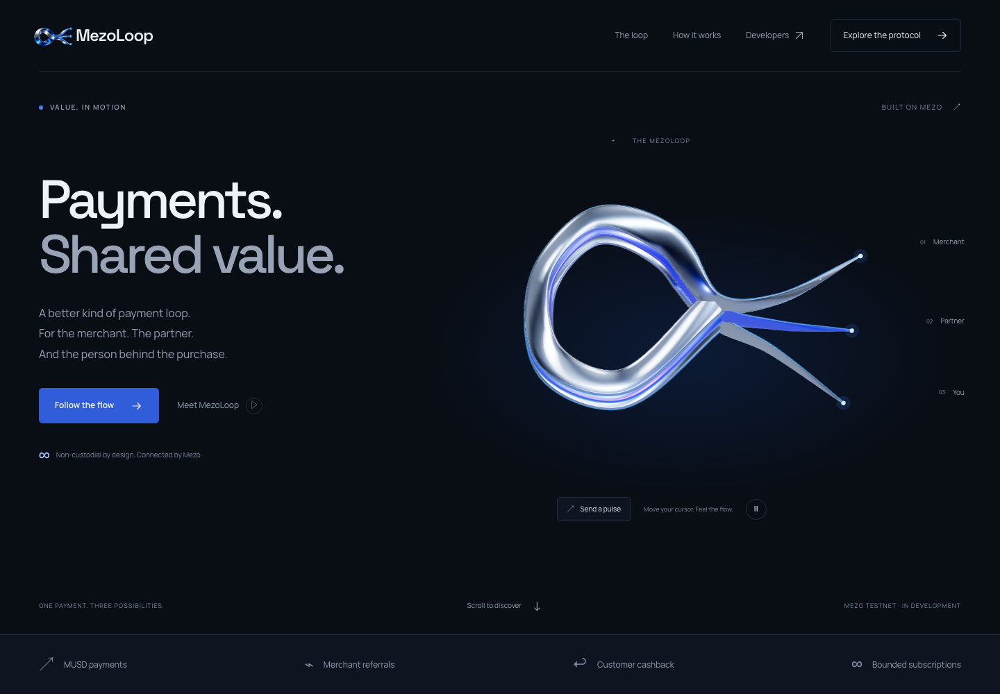
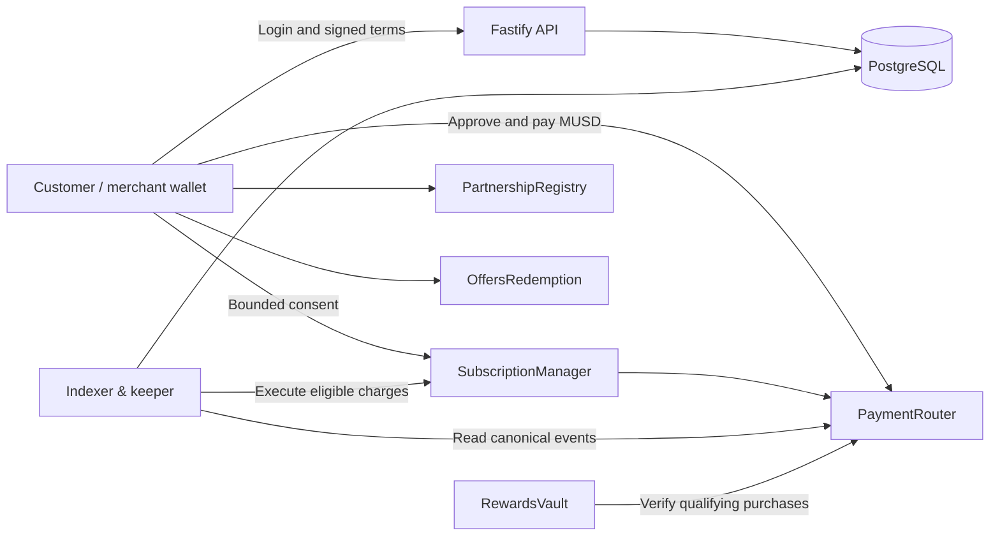

<p align="center">
  
</p>

<p align="center">
  <strong>Non-custodial payments, merchant referrals, and customer rewards on Mezo.</strong>
</p>

<p align="center">
  <a href="https://github.com/Anu062004/Mezzzzzzzooo/actions/workflows/checks.yml"></a>
  
  
  
</p>

<p align="center">
  <a href="#overview">Overview</a> ·
  <a href="#architecture">Architecture</a> ·
  <a href="#getting-started">Getting started</a> ·
  <a href="#verification">Verification</a> ·
  <a href="docs/protocol.md">Protocol reference</a>
</p>

## Overview

MezoLoop combines MUSD checkout with merchant-approved referral commissions and customer cashback. A merchant signs the payment terms, the customer authorizes the transaction in their wallet, and the payment router distributes the funds atomically. Hosted services manage authentication, order metadata, and reconciliation; financial settlement remains on-chain.

**Repository status:** five smart contracts, backend services, wallet-connected merchant and customer interfaces, and an interactive 3D landing page. Hosted API/worker setup, deployed contract configuration, and complete real-testnet payment verification remain required. The contracts have not undergone an independent security audit.

### Interactive landing page

[Explore the live experience](https://mezoloop.vercel.app)



The Next.js landing page brings the MezoLoop identity into motion with a metallic WebGL loop, cursor-reactive lighting, animated payment paths, and an interactive split calculator. It includes mobile layouts, keyboard navigation, pause controls, and reduced-motion/WebGL fallbacks. The calculator is an illustration and does not move funds.

```sh
npm run web:dev
```

Open `http://localhost:3000`. For a production build, run `npm run web:build` followed by `npm run web:start`. Set `PUBLIC_SITE_URL` to your deployed origin when building for hosting.

[Download the transparent logo](apps/web/public/brand/mezoloop-logo.png)

### Merchant and customer workspaces

[Merchant workspace](https://mezoloop.vercel.app/merchant) · [Customer account](https://mezoloop.vercel.app/customer)

Merchants can create and sign checkout links, share QR codes, review sales, manage referrals, fund rewards, issue offers, and prepare bounded subscription plans. Customers can scan a QR, review exact payment terms, pay through their wallet, recover a submitted payment after refresh, download or print verified receipts, claim eligible rewards, and cancel recurring billing. Selected merchant checkouts update automatically as payments are confirmed. Live actions require the configured API and deployed contracts. See [frontend setup and behavior](docs/frontend.md).

### Deploy to Vercel

From the repository root, run `vercel --prod`. The included configuration builds the Next.js application, including dynamic checkout routes and a same-origin API proxy. Set the server-only `API_ORIGIN` on Vercel to your hosted API origin. Vercel supplies the production domain for social-sharing metadata; `PUBLIC_SITE_URL` can override it. The Fastify API, PostgreSQL database, and worker require separate hosting. The [deployment guide](docs/deployment.md) covers the Docker services, contract deployment script, configuration, and verification.

### Capabilities

| Area | Implementation |
| --- | --- |
| Payments | EIP-712 merchant authorization, exact integer splits, order replay protection, cancellation, and merchant-funded refunds |
| Authentication | Wallet challenges, single-use nonces, expiring sessions, HTTP-only cookies, and merchant access controls |
| Checkout API | Idempotent order creation, immutable financial terms, QR checkout URLs, token approval and payment calldata |
| Referrals | Merchant-approved partnership records and on-chain approval/revocation |
| Rewards | Merchant-funded campaign budgets, purchase eligibility, one claim per campaign/payment, and expiry-based reclaim |
| Subscriptions | Signed plans, bounded charge amounts and counts, billing intervals, customer cancellation, and keeper execution |
| Offers | Signed customer-specific discount commitments with expiry and redemption protection |
| Reconciliation | Persistent block cursors, canonical event storage, confirmation states, and reorg-aware projections |
| Webhooks | Merchant-authorized registration, encrypted delivery secrets, HMAC signatures, and retry scheduling |

### Payment economics

For an illustrative **20 MUSD** payment with **3% referral commission** and **5% cashback**:

| Recipient | Amount |
| --- | ---: |
| Merchant | 18.40 MUSD |
| Referral partner | 0.60 MUSD |
| Customer cashback | 1.00 MUSD |
| **Total distributed** | **20.00 MUSD** |

Cashback comes from the original payment. MEZO rewards use a separate, pre-funded campaign budget. Platform fees are currently zero.

## Architecture



### Smart contracts

| Contract | Responsibility |
| --- | --- |
| [`PaymentRouter.sol`](contracts/src/PaymentRouter.sol) | Validates signed orders and settles MUSD splits atomically; supports cancellation and refunds |
| [`SubscriptionManager.sol`](contracts/src/SubscriptionManager.sol) | Stores customer consent, enforces billing limits, and routes recurring payments |
| [`RewardsVault.sol`](contracts/src/RewardsVault.sol) | Accounts for merchant campaign funding and distributes eligible rewards |
| [`PartnershipRegistry.sol`](contracts/src/PartnershipRegistry.sol) | Records merchant-approved referral terms and revocations |
| [`OffersRedemption.sol`](contracts/src/OffersRedemption.sol) | Validates and records one-time, customer-specific offer redemptions |

The router creates its subscription manager at deployment. It has no administrator-controlled customer withdrawal path. Wallets sign payment authorization directly; the API does not hold customer or merchant private keys.

## Getting started

### Prerequisites

- Node.js **22 or newer** and npm.
- Docker with Compose, or a PostgreSQL instance.
- [Foundry](https://getfoundry.sh/) for contract builds and tests.

### Install and start the API

```sh
git clone https://github.com/Anu062004/Mezzzzzzzooo.git
cd Mezzzzzzzooo
npm ci
cp .env.example .env
docker compose up -d db
npm run db:migrate
npm run contracts:build
npm run dev
```

The API listens on `http://localhost:3001` by default. `GET /health/live` reports process liveness; `GET /health/ready` checks database availability.

The default environment supports wallet authentication and merchant records without a deployed router. Creating payment quotes requires a valid `PAYMENT_ROUTER_ADDRESS`. When configured, startup validates the RPC chain, MUSD decimals, and router token binding.

### Start the worker

After deploying the contracts and setting their addresses and deployment block in your private environment:

```sh
npm run worker
```

The worker indexes contract events and updates order projections. Subscription execution is enabled only when a keeper key is configured. Webhook delivery requires a separate encryption key.

### Configuration

Copy [`.env.example`](.env.example) and configure the values locally. The example contains local-development defaults and public network information only.

| Variable | Purpose |
| --- | --- |
| `DATABASE_URL` | PostgreSQL connection |
| `API_ORIGIN` | Server-only URL used by the web app to reach Fastify |
| `PUBLIC_SITE_URL` | Optional public origin for web metadata |
| `PUBLIC_APP_URL` | Exact browser origin used for authentication and checkout links |
| `MEZO_RPC_HTTP` | Primary RPC endpoint |
| `MEZO_RPC_FALLBACK` | Optional fallback RPC endpoint |
| `PAYMENT_ROUTER_ADDRESS` | Deployed router address |
| `REWARDS_VAULT_ADDRESS` | Optional rewards vault address |
| `PARTNERSHIP_REGISTRY_ADDRESS` | Optional partnership registry address |
| `OFFERS_ADDRESS` | Optional offers contract address |
| `INDEXER_START_BLOCK` | First block to scan, normally the deployment block |
| `CONFIRMATIONS` | Depth required for confirmed payments |
| `FINALITY_CONFIRMATIONS` | Application-level finality depth |
| `WORKER_PRIVATE_KEY` | Optional gas-funded keeper key; configure through a secret manager |
| `WEBHOOK_ENCRYPTION_KEY` | Optional 32-byte encryption key, hex-encoded; configure through a secret manager |

Use HTTPS in production and serve the frontend/API through the same origin. State-changing API requests require an `Origin` header matching `PUBLIC_APP_URL`. Secrets belong in local environment files or the hosting provider's secret manager, never in source files or documentation.

## API surface

All application endpoints use the `/v1` prefix. Monetary quantities are decimal strings representing atomic token units.

| Group | Representative routes |
| --- | --- |
| Authentication | `/auth/challenge`, `/auth/verify`, `/auth/session`, `/auth/logout` |
| Merchants | `/merchants`, `/merchants/:id/orders`, `/merchants/:id/analytics` |
| Checkout | `/orders`, `/orders/:id/authorize`, `/orders/:id/qr`, `/orders/:id/prepare` |
| Payment lifecycle | `/orders/:id/transactions`, `/orders/:id/status`, `/orders/:id/cancel`, `/orders/:id/refund` |
| Referrals | `/partnerships`, `/partnerships/:id/accept`, `/partner/sales` |
| Rewards | `/campaigns`, `/campaigns/:id/fund`, `/campaigns/:id/claim`, `/campaigns/:id/reclaim` |
| Recurring payments | `/subscriptions/prepare`, `/subscriptions/plans/:id/subscribe`, `/subscriptions/:id/cancel` |
| Offers and callbacks | `/offers`, `/offers/:id/redeem`, `/webhooks` |
| Receipts and operations | `/receipts`, `/network`, `/operations` |

Order creation requires an `Idempotency-Key`. Transaction submission returns **202 Pending**; a browser callback or submitted transaction hash cannot independently confirm a payment. Cancellation, funding, and other on-chain actions return transaction data for the user's wallet to authorize.

## Verification

```sh
npm run typecheck
npm test
npm run contracts:test
npm run test:payments
npm run chain:smoke
npm run web:build
npx playwright install chromium
npm run web:test
```

- **Backend tests** exercise wallet authentication, session replay and expiry, merchant access, immutable quotes, idempotency, tampered signatures, monetary precision, and pending-only transaction submissions using embedded PostgreSQL.
- **Contract tests** cover settlement, refunds, replay, atomic failure, reward budgets, subscriptions, registry permissions, and offer redemption. Split conservation is fuzz-tested across 256 randomized inputs.
- **Chain smoke checks** read the configured testnet and token interface without broadcasting a transaction. They do not establish successful payment settlement.
- **Browser tests** cover the 3D controls, calculator, navigation, modal, logo download, responsive layouts, reduced motion, and unavailable WebGL. Workspace tests also exercise wallet sign-in, checkout signing and draft recovery, exact approval/payment requests, rejection of tampered calldata, session changes, safe QR links, and mobile layouts.
- **CI** runs TypeScript checks, backend and contract tests, frontend build/browser checks, PostgreSQL migration checks, and dependency auditing.

A disposable Anvil/PostgreSQL integration test verifies API-to-contract settlement, worker restart, confirmation isolation, and reorg recovery. Complete hosted checkout verification with actual Mezo Testnet assets remains required.

## Repository structure

```text
apps/
  api/src/           Authentication, merchant workflows, checkout and protocol APIs
  worker/src/        Chain indexing, recurring execution and webhook delivery
  web/               Next.js landing page, wallet workspaces, API proxy and brand assets
contracts/
  src/               Solidity protocol contracts
  test/              Foundry unit and fuzz tests
  script/            Guarded Mezo Testnet deployment
packages/
  chain/             Shared ABIs, typed signatures, chain configuration and reads
  db/                PostgreSQL migrations and transaction helpers
scripts/             ABI generation
tests/              Backend integration tests
docs/               Protocol reference and project artwork
```

## References

- [Deployment and payment verification](docs/deployment.md)
- [Protocol design and implementation notes](docs/protocol.md)
- [Mezo developer environment](https://mezo.org/docs/developers/getting-started/configure-environment/)
- [Mezo token and contract reference](https://mezo.org/docs/users/resources/contracts-reference)
- [OpenZeppelin Contracts](https://docs.openzeppelin.com/contracts/5.x/)
